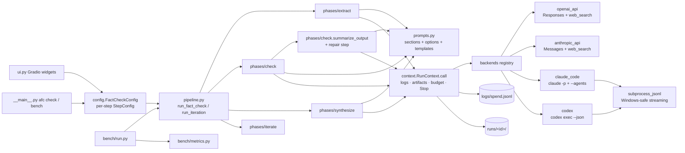

# Auto Fact-Checker

A local, configurable **rigorous fact-checker**. A long expert fact-checking prompt is split into "Lego" blocks.
Each block is a checkbox, slider, dropdown or text box in a Gradio UI. You can run it anywhere from **one
non-agentic API call** up to **Claude Code / Codex agents that spawn subagents**, or **separate calls per claim and
per scientist**. Every claim gets an accuracy score, every verdict label and evaluative condition gets a
**0–100 % score plus a confidence %**, and the corrected text can be re-checked **iteratively** until it is accurate.

## Methodology

**1. The prompt as building blocks.** [`prompts/original_prompt.md`](prompts/original_prompt.md) is split into 24
toggleable sections. They are verbatim except for light rewording where a sentence had to be cut into separate blocks ([`prompts/sections/`](prompts/sections)). The added options are:
- the NeurIPS-reviewer role
- claim classification
- 0–100 % scoring
- confidence %

The list-valued parts are editable checkbox groups ([`prompts/options.json`](prompts/options.json)):
- 45 verdict labels
- the degrees fully/partially/slightly
- the style adjectives
- 63 scientists
- claim types

A golden test checks that the all-on prompt still contains every list item and every verbatim sentence of the
original.

**2. Every condition is scored, with confidence.** The prompt asks the model to end with a JSON summary
([`prompts/json_summary.md`](prompts/json_summary.md)). Each claim in that summary has:
- `accuracy_pct` and `confidence_pct`
- claim types, each with a confidence
- every selected verdict label, with a degree, `score_pct` and `confidence_pct`
- every evaluative condition of the original prompt, with a finding, a `score_pct` whose meaning is defined, and a
  `confidence_pct`. The conditions are: omitted nuance, the five strengths/weaknesses pairs, the empiricist,
  rationalist, Bayesian and frequentist perspectives, predictive power, and explanatory power.
- a corrected claim

The summary also contains a corrected whole text and a one-sentence-per-issue list. A field exists only while its
section is switched on.

**3. Granular execution: modes are only presets.** A run has five steps: **extract → check → perspective →
synthesize → repair**. Each step has its own settings:
- API call or agent
- OpenAI or Anthropic
- model (any listed model, with its price)
- reasoning effort ("depth")
- web search on or off, search context size and maximum number of searches
- blocked domains
- whether the agent may spawn subagents
- prompt template (any `.md` in `prompts/<step>/`) or a full prompt override

Two global strategies decide how the text is split into calls:
- **claims:** check the whole text at once, one subagent per claim, or one separate call per claim after
  Claimify-style extraction
- **scientists:** named in the prompt only, one subagent per scientist, or one separate call per scientist

**4. Iteration.** *Iterate until accurate* re-checks the corrected text until every claim reaches the accuracy
threshold. It also stops at the iteration limit, when the corrected text stops changing, or when the budget runs
out. The **One more iteration** button re-checks the latest corrected text once and can be pressed any number of
times.

**5. Evaluation.** A pre-registered benchmark harness compares configurations on the same items. The data is
SciFact claims, labelled SUPPORT vs CONTRADICT. The statistics are balanced accuracy, Wilson CIs, an exact
McNemar test and paired-bootstrap CIs. Search results are filtered with dataset-host domain blocking and every
source URL is checked for leakage. Design: [`docs/benchmark.md`](docs/benchmark.md). Results:
[`reports/`](reports).

## Results so far

These are pre-registered SciFact runs (n = 200 balanced claims, `gpt-6-luna`, one call per claim). Full details
are in [`reports/all_experiments.md`](reports/all_experiments.md) and the paper is
[`reports/paper/paper.pdf`](reports/paper/paper.pdf).

| system | balanced accuracy [95% CI] | cost / 200 claims |
|---|---|---|
| A simple call, no search | 0.755 [0.691, 0.809] | $0.06 |
| B full rigorous prompt + web search | 0.865 [0.811, 0.906] | $2.97 |
| C simple prompt + web search | 0.890 [0.839, 0.926] | $2.30 |
| D full rigorous prompt, no search (post hoc) | 0.765 [0.702, 0.818] | $0.44 |

On 40 of the same claims (post hoc), agents running the full prompt were not better:
- Codex: balanced accuracy 0.876
- Claude Code with Haiku: 0.797, though with the best ranking (AUROC 0.962)

- **Web search is what helps.** B beats A by +0.110 [+0.062, +0.160] (McNemar p = 2.7 × 10⁻⁵), and search alone
  explains it (C − A = +0.135).
- **The rigorous prompt does not change verdict accuracy** with search (B − C = −0.025 [−0.061, +0.010]) or without
  it (D − A = +0.010).
- **The prompt's added value is the richer qualitative output**: label and condition scores with confidences,
  corrections and issue lists. SciFact does not measure that.

**Does "iterate until accurate" produce correct text?** Only partly (Exp07, pre-registered). A Codex agent with
web search, looping on 100 claims and judged against the gold evidence:
- raised correctness from 49% to 62%
- labelled every one of its answers correct, although only 62% were
- gained nothing from passes after the first correction

Treat the loop's "accurate" label as a claim to verify, not a verification.

The whole project, from implementation through evaluation, cost $6.90 in billed API calls.

## Quick start

```bash
git clone https://github.com/BurnyCoder/auto-fact-checker && cd auto-fact-checker
uv sync                      # creates .venv with Python 3.13 and all dependencies
cp .env.example .env         # then put your OPENAI_API_KEY / ANTHROPIC_API_KEY in .env
uv run afc ui                # opens http://127.0.0.1:7860
```

Optional, needed only for agent steps:
- [Claude Code](https://code.claude.com/docs/en/setup) (`claude`) and/or
  [Codex CLI](https://learn.chatgpt.com/docs/non-interactive-mode) (`codex`) on `PATH`, logged in.
- With `AGENT_AUTH=subscription` (the default), API keys are removed from the agents' environment, so agents use
  those logins. Set `AGENT_AUTH=api_key` to bill the keys instead.

Command line:

```bash
uv run afc check examples/ai_research.md --preset L1_single_call_search
uv run afc check my.txt --preset L4_extract_then_agent_per_claim --set steps.check.model=gpt-6.1-sol --iterations 3
uv run afc spend             # cumulative billed spend vs SPEND_LIMIT_USD
uv run afc bench --systems configs/bench/baseline.json configs/bench/full_single_openai.json --n 20 --max-cost 1 --out reports/results/demo
```

## Features

**Every block of the original prompt is a toggle**:
- the sentence sections
- the verdict labels, degrees, style words, scientists and claim types, each list extendable with your own items
- a custom-instructions box

**Scores and confidence per claim, label and condition**:
- Labels can be scored for every label, or only for the labels that apply.
- An optional per-scientist "standards" condition can be added.
- The UI shows Claims, Labels and Conditions tables.

**Per-step backends**:

| step kind | OpenAI | Anthropic |
|---|---|---|
| API call | Responses API + hosted `web_search` | Messages API + `web_search_20260318` |
| agent | Codex CLI `codex exec` (live search) | Claude Code `claude -p` (WebSearch/WebFetch, subagents via `--agents`) |

**Strategies**:
- whole text, one subagent per claim, or one separate call per claim
- one subagent per scientist, or one separate call per scientist
- one independent call per **scientist button** in the UI, plus "Synthesize perspectives"

**Presets L0–L5** (in [`configs/presets/`](configs/presets)) go from a single call without search up to separate
claim × scientist calls. You can save your own.

**Iteration**: iterate until accurate, plus the endless **One more iteration** button.

**Prompt preview**: the exact prompts each call type would send, and the `--agents` JSON.

**Logging**:
- Timestamped `logs/<time>.log` and terminal output in real time.
- Every prompt and output in full, never truncated.
- A per-run `runs/<id>/run.log` (shown live in the UI) and per-call artifact files.

**Cost control**:
- Price catalog for all models.
- Per-run budget.
- Persistent ledger `logs/spend.jsonl` with a global `SPEND_LIMIT_USD` cap, checked before every call. It is a
  soft cap: parallel in-flight calls can overshoot slightly.
- Claude Code `--max-budget-usd`, and search caps (`max_tool_calls` / `max_uses`).

**Benchmark harness**: resumable, cost-capped, paired statistics, leakage flags.

## Technologies

Python 3.13 and [uv](https://docs.astral.sh/uv/) ·
[Gradio 6](https://www.gradio.app/) ·
[OpenAI Python SDK](https://github.com/openai/openai-python) (Responses API) ·
[Anthropic Python SDK](https://github.com/anthropics/anthropic-sdk-python) ·
[Claude Code](https://code.claude.com/docs/en/headless) and [Codex CLI](https://learn.chatgpt.com/docs/non-interactive-mode) ·
pydantic / pydantic-settings · Jinja2 · json-repair · psutil ·
🤗 datasets / pandas (SciFact) · scikit-learn · statsmodels · pytest.

## What happens when you run it

1. **Configuration.** The UI widgets (or a preset plus `--set` overrides) become one `FactCheckConfig`.
2. **Run record.** `pipeline.run_fact_check` creates a run (`runs/<run_id>/`) and a `RunContext`. That context is
   the only path to the LLMs. For each call it:
   - checks the global spend cap and the per-run budget
   - logs the full prompt
   - writes `calls/NNN_<label>.prompt.md`
   - calls the backend
   - logs the full output, tokens, searches, cost and sources
   - writes `.output.md` and `.result.json`
   - appends to `logs/spend.jsonl`
3. **One iteration.** The input is the original text, or the latest corrected text.
   1. If the claim strategy is *one separate call per claim*: the **extract** step returns self-contained claims.
   2. **check** calls run in parallel (`max_parallel`): one per target, i.e. the whole text or each claim. With
      *one separate call per scientist*, each target also gets one **perspective** call per scientist.
   3. With subagent strategies, a single Claude Code agent receives an orchestration prompt plus a `--agents` file,
      and spawns `claim-checker` / `scientist-perspective` subagents itself.
   4. Every answer's JSON summary is parsed tolerantly. If it is missing, the **repair** step extracts it.
   5. **synthesize** merges per-scientist results per claim, then all claims into one report with a corrected
      whole text.
4. **Stopping.** `iterate.should_stop` decides whether to run another pass (threshold, fixed point, missing
   summary); budget and Stop are enforced per call by `RunContext`. The UI shows the result in tabs:
   - Report, Claims, Labels, Conditions, Corrected text, Issues
   - Iterations, Calls & cost, Live log
   - Prompt preview, Raw JSON

## Architecture



More detail is in [`docs/architecture.md`](docs/architecture.md). Every setting is listed in
[`docs/configuration.md`](docs/configuration.md).

## Costs and safety

- The default models are the cheapest: `gpt-6-luna` ($0.10/$0.50 per 1M tokens) and `claude-haiku-5-5`
  ($0.10/$0.50). Web search costs about $0.01 per search with both providers, and that dominates the cost of a
  call. All prices are in `src/auto_fact_checker/catalog.py`, with source links.
- Agents run **without permission prompts or a sandbox**, as the project specifies
  (`--dangerously-skip-permissions`, `--dangerously-bypass-approvals-and-sandbox`). The measures that are not
  sandboxing:
  - each agent runs in a fresh temporary directory
  - Claude Code skips your settings, MCP servers, plugins and CLAUDE.md files
  - Codex skips `config.toml` and its desktop features. Your global `~/.codex/AGENTS.md` is only excluded in
    `AGENT_AUTH=api_key` mode; in subscription mode a developer instruction tells the agent to ignore it.
  - API keys are stripped in subscription mode
  - the checked text is wrapped in tags marked as data
  - budgets and timeouts apply
  - the UI only listens on 127.0.0.1

  Web pages or the text being checked can still contain prompt injections aimed at an agent that has shell access.
  Do not run agent steps on machines holding secrets you cannot risk.

## Repository layout

```
prompts/        original prompt, sections/, options.json, json_summary.md, per-step templates (check/ extract/ …)
configs/        presets/ (UI "modes") and bench/ (pre-specified benchmark systems)
src/auto_fact_checker/
  config.py catalog.py spend.py logs.py prompts.py schema.py results.py context.py render.py
  pipeline.py (the wrapper)  phases/  backends/  bench/  ui.py  __main__.py
examples/       AI research / philosophy / engineering texts with planted errors (answer key: docs/examples.md)
docs/           architecture, configuration, benchmark design, example answer key
reports/        experiment reports, all_experiments.md, paper/
tests/          offline pytest suite (fake backend) + live tests (`-m live`)
```

## Tests

```bash
uv run pytest            # offline: fake backend, no network, no cost
uv run pytest -m live    # real calls to gpt-6-luna / claude-haiku-5-5 / claude / codex (a few cents)
```

## Data and licences

SciFact (Wadden et al., 2020) is CC BY-NC 2.0 and is downloaded at run time from the
[Hugging Face parquet export](https://huggingface.co/datasets/allenai/scifact). Claim extraction follows Claimify
(Metropolitansky & Larson, 2025, [arXiv:2502.10855](https://arxiv.org/abs/2502.10855)).
