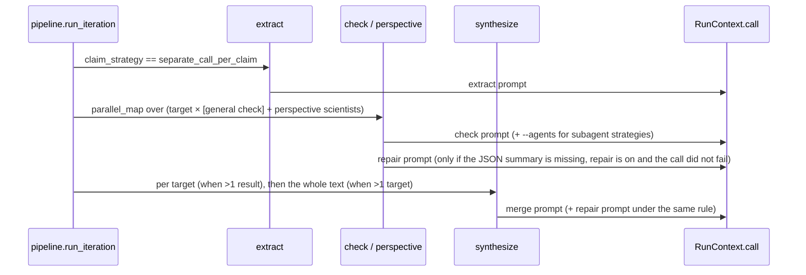

# Architecture

This page describes how the modules fit together. The overview graph is in the [README](../README.md#architecture).

## Modules and responsibilities

| module | responsibility |
|---|---|
| `config.py` | `.env` `Settings`; `StepConfig` (per step); `FactCheckConfig` (whole run); presets; dotted overrides; `active_conditions()` |
| `catalog.py` | model price table (verified 2026-10-17, re-checked 2026-10-22), `cost_usd()` including long-context tiers (input, cached input, output) and $0.01/search |
| `spend.py` | append-only `logs/spend.jsonl`, `check_budget()` against `SPEND_LIMIT_USD` |
| `logs.py` | one timestamped log file per process plus the terminal; `log_block()` for full prompts/outputs; per-run log handlers filtered by `run_id` |
| `prompts.py` | Jinja2 rendering of `prompts/`: `sections_text`, `output_contract`, `build_prompt(cfg, step, text, …)`, `build_agents(cfg)` |
| `schema.py` | the JSON output contract (`FactCheckSummary`, `ClaimVerdict`, `LabelScore`, `Assessment`, `ClaimType`, `ClaimList`), the benchmark judge and injection models (`JudgeVerdict`, `InjectedError`/`InjectionList`, `RefError`/`RefVerdict`) and `parse_block()` |
| `results.py` | `CheckResult`, `IterationResult`, `FactCheckRun` (+ `current_text`), `CallRecord`, in-memory `RUNS`, `runs/<id>/run.json` |
| `context.py` | `RunContext.call()`: the single LLM choke point; `stop_run()` |
| `phases/` | `extract_claims`, `check` (+ `summarize_output` → repair), `synthesize` (LLM or deterministic merge), `should_stop` |
| `pipeline.py` | `run_fact_check` → `run_iteration`; `run_perspective`; `synthesize_perspectives`; `parallel_map` |
| `backends/` | `openai_api`, `anthropic_api`, `claude_code`, `codex`, shared `subprocess_jsonl` |
| `render.py` | Markdown report and table rows shared by the UI and the CLI |
| `ui.py` | Gradio Blocks: StepConfig widgets generated from the fields, FactCheckConfig fields listed per tab |
| `bench/` | `datasets` (SciFact), `metrics`, `run` (`afc bench`), `correction` + `judge` (`afc correct-eval`, Exp07), `ai_errors` + `sources` + `judge` (`afc ai-errors`, Exp08) |

## Call graph of one iteration



## How the backends map the settings

| StepConfig field | OpenAI Responses | Anthropic Messages | Claude Code | Codex |
|---|---|---|---|---|
| `effort` | `reasoning.effort` | `output_config.effort` (none/minimal → low) | `--effort` (none/minimal → low) | `-c model_reasoning_effort=` |
| `web_search` | `web_search` tool | `web_search_20260318` tool | WebSearch/WebFetch allowed, else `--disallowedTools` | `-c web_search="live"` / `"disabled"` |
| `max_searches` | `max_tool_calls` | `max_uses` | stated in the prompt | stated in the prompt |
| `blocked_domains` | `filters.blocked_domains` | `blocked_domains` | stated in the prompt | stated in the prompt |
| `allow_subagents` | n/a | n/a | allow the `Agent` tool; `--agents` file for strategies | `--enable multi_agent` |
| `max_turns` | n/a | n/a | `--max-turns` | n/a |
| cost | computed from tokens | computed from tokens | `total_cost_usd` (includes subagents) | computed from tokens |

Agent isolation:
- **Claude Code:** `--setting-sources project --strict-mcp-config --disable-slash-commands --no-session-persistence`,
  plus a `--settings` file with `claudeMdExcludes` (CLAUDE.md, CLAUDE.local.md, AGENTS.md, rules) and
  `autoMemoryEnabled: false`.
- **Codex:** `--ignore-user-config --ignore-rules --ephemeral --skip-git-repo-check`, with the `computer_use`,
  browser, apps, plugins and hooks features disabled, and a `developer_instructions` note telling the agent to ignore
  coding/project instructions from AGENTS.md files. With `AGENT_AUTH=api_key`, `CODEX_HOME` is an empty temporary
  directory, so the global `~/.codex/AGENTS.md` is not loaded.
- **Both:** a fresh temporary working directory per call. With `AGENT_AUTH=subscription`, `ANTHROPIC_API_KEY`,
  `ANTHROPIC_AUTH_TOKEN`, `OPENAI_API_KEY` and `CODEX_API_KEY` are removed from the child environment.

Sources:
- [OpenAI web search guide](https://developers.openai.com/api/docs/guides/tools-web-search)
- [Anthropic web search tool](https://platform.claude.com/docs/en/agents-and-tools/tool-use/web-search-tool)
- [Claude Code CLI reference](https://code.claude.com/docs/en/cli-reference)
- [Codex non-interactive mode](https://learn.chatgpt.com/docs/non-interactive-mode) and
  [Codex CLI reference](https://learn.chatgpt.com/docs/cli/reference)

## Persistence

```
logs/<YYYYmmdd_HHMMSS>.log     every log line of the process (terminal mirror)
logs/spend.jsonl               one line per LLM call: ts, label, cost_usd, billed, run_id, backend, model, searches
runs/<run_id>/run.log          only this run's lines (the UI's Live log tab)
runs/<run_id>/run.json         full FactCheckRun (config, iterations, reports, summaries, call records)
runs/<run_id>/report.md        rendered report (CLI)
runs/<run_id>/calls/NNN_<label>.{prompt.md,output.md,result.json,agents.json}
```
