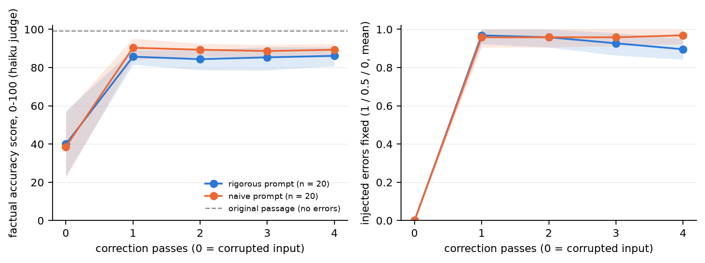

# Exp08 — Does iterative correction fix obviously wrong AI-research text?

**Pre-registration:** [`docs/ai_error_bench.md`](../../docs/ai_error_bench.md). It was committed (PR #19) before the
dataset was built and before any correction or judge call, together with the analysis script
[`reports/scripts/analyze_ai_errors.py`](../scripts/analyze_ai_errors.py). Its statistical calculations are
unchanged; a figure-axis label was clarified on 2026-10-22 to distinguish partial-credit scores from full fixes.

**Data:**
- benchmark: [`benchmarks/ai_errors_v1/`](../../benchmarks/ai_errors_v1), frozen in PR #20 before any correction run
- records: `reports/results/exp08_ai_errors/ai_{naive,rigorous}_codex.jsonl`
- analysis: `reports/results/ai_errors_analysis.json`
- post hoc: `reports/results/exp08_posthoc.json`, from [`exp08_posthoc.py`](../scripts/exp08_posthoc.py)
- figure: [`fig4_ai_errors_passes.png`](../figures/fig4_ai_errors_passes.png)

**Date:** 2026-10-17.

## Question

Can a fact-checking agent repair text about AI research that contains obviously wrong claims? Does running the
correction several times make the text better than running it once? Does a long rigorous prompt beat a naive
"Fact-check the following text." prompt?

## Method (as pre-registered)

**Benchmark.**
- 20 real passages: 10 Wikipedia lead sections and 10 arXiv abstracts about AI research (AlexNet, Transformer,
  GPT-3, RLHF, ResNet, LoRA, Chinchilla, …). Each is 107–180 words.
- Each passage got k ∈ {0, …, 5} annotated edits (seed 0, same k distribution per source), 48 in total.
- The 4 passages with k = 0 have no injected edits; their source text is not independently error-free.
- Each edit was intended to change one checkable fact. One is ambiguous (see the dated reassessment). Types:
  - wrong number/year: 15
  - swapped entity: 13
  - negation/reversal: 11
  - absurd overclaim: 5
  - wrong person/organisation: 4
- One `gpt-6-luna` call proposed each passage's errors; code validated them.
- The AI coding agent that builds this repository (not a human) read all 48 as word diffs and edited 6: 4 repairs
  and 2 type relabels (log in the dataset README). Examples of injected errors: 2012 → 2022, 175 billion →
  175 million parameters, 28.4 → 284 BLEU, CIFAR-10 → CIFAR-100, "does not inherently make them better" →
  "inherently makes them better".

**Arms.**
- **Agent:** Codex (`gpt-6-luna`, effort low), live web search; the prompt requests at most 3 searches per pass.
- **Hosts:** none blocked; finding the source is legitimate fact-checking.
- **Prompts:**
  - *Naive:* "Fact-check the following text." plus the minimal JSON contract with `corrected_text`.
  - *Rigorous:* the full default prompt.
- **Forced 4 passes:** pass p checks pass p − 1's corrected text. State 0 is the corrupted input.
- **Derived self-stop:** the answer the default loop (threshold 90%) would have returned.

**Scoring on a spectrum.**
- A reference judge gets the original passage, the injected errors (wrong → true fact) and a candidate text, and
  uses no web.
- It returns:
  - a status per injected error: corrected = 1, partially = 0.5, uncorrected = 0
  - "introduced errors"
  - `overall_accuracy_pct` (0–100), the **primary score**
- Primary judge: `claude-haiku-5-5`, cross-family. Secondary judge: `gpt-6-luna`.
- Paired over the 20 passages: mean Δ with a paired-bootstrap 95% CI, and Wilcoxon signed-rank (Pratt).
- Error-level rates use a cluster bootstrap by passage.

## Validity (gate passed)

| check | Haiku (primary) | Luna |
|---|---|---|
| original passage: mean score (min) | 99.1 (80) | 100 (100) |
| original passage: errors marked corrected / introduced errors | 0.98 / 0 | 1.00 / 0 |
| corrupted input: errors marked corrected | 0.00 | 0.00 |
| corrupted input: mean score for k = 0 / 1 / 2 / 3 / 4 / 5 | 100 / 66 / 39 / 13 / 7.5 / 7.5 | 100 / 94 / 81 / 76 / 60 / 60 |
| Spearman ρ (k, corrupted-input score), descriptive | −0.81 | −0.92 |
| test–retest: the same corrupted text judged in both arms, mean \|Δ\| | 3.9 points | 4.5 points |

**Gate:** originals ≥ 90 and corrupted-input fix rate ≤ 0.2. Both held (checked from the `validity` fields of
`ai_errors_analysis.json`; the script does not apply the gate itself).
The stored correlation p-values pool two judgments of each of 20 passages and treat them as independent;
they are not reported as inferential evidence here. Passing the gate does not validate every judgment.

**Further checks:**
- A deterministic number check (true number present ∧ false number absent) agrees with Haiku's per-error status on
  85% of 140 number-error states (κ = 0.66).
- The judges rank texts similarly (Spearman 0.70 over 232 texts) but Haiku is much harsher: a mean absolute
  difference of 13.9 points (Haiku 13.7 points lower on average), largest on corrupted text.

## Results

**Fig. 4.** Mean score and mean per-error fix score after each pass, with 95% bootstrap bands (n = 20 passages,
48 annotated edits). Pass 0 is judged separately in each arm, hence 40.0 vs 38.6.

| primary judge (Haiku) | naive prompt | rigorous prompt |
|---|---|---|
| score: corrupted input → pass 1 → 2 → 3 → 4 | 38.6 → **90.4** → 89.4 → 88.7 → 89.4 | 40.0 → **85.7** → 84.4 → 85.4 → 86.2 |
| weighted edit-fix score (mean of 1 / 0.5 / 0), pass 1 → 4 | 0.958 → 0.969 | 0.969 → **0.896** |
| fully corrected errors, pass 1 → 4 (of 48) | 44 → 45 | 45 → **38** |
| introduced errors per passage, pass 1 → 4 | 0.40 → 0.40 | 0.70 → 0.45 |
| self-rated accuracy of the text checked, pass 1 → 4 | 68 → 98 | 64 → 96 |
| time / output tokens per pass | 18 s / 1.5k | 110 s / 18k |
| notional agent cost per passage (4 passes; with billed judges) | $0.093 ($0.096) | $0.132 ($0.137) |

**H3 — one pass helps a lot (supported in both arms).**
- *Naive:* corrupted input → pass 1 Δ = **+51.8 [+34.1, +68.9]**, Wilcoxon p = 0.0007.
- *Rigorous:* Δ = **+45.8 [+28.8, +61.9]**, p = 0.0009.
- The 4 passages that got worse are the 4 clean controls.
- One pass fully corrected 44/48 (91.7%) and 45/48 (93.8%) annotated edits according to Haiku.
  The weighted scores 0.958 and 0.969 also grant half credit to partial fixes; they are not percentages fully fixed.

**H1 — no detectable improvement from more passes in this sample.**
- *Rigorous*, pass 4 vs pass 1: Δ = **+0.45 [−4.55, +4.80]** (10 better, 8 worse, 2 same), p = 0.43.
- *Naive:* Δ = −1.0 [−6.75, +5.30], p = 0.13.
- *Luna judge* (robustness): rigorous +2.2 [−0.25, +4.75]; naive −1.55 [−3.60, +0.45]. Both CIs include 0.
- *Net fixes* (Σ fix − introduced): rigorous +0.08 [−0.35, +0.48], naive +0.03 [−0.33, +0.40].
- **Reading:** the prespecified support criterion is not met. The interval permits both improvement and harm;
  the planned detectable effect size is not a bound on effects compatible with these observations.

**Secondary (pre-registered): iteration erodes fixes under the rigorous prompt.**
- Per-passage fix rate, pass 4 vs 1: **−0.067 [−0.117, −0.022]**. 6 of 16 passages are worse and none better,
  p = 0.015.
- The naive prompt holds its fixes: +0.006 [0.000, +0.019].
- By error type (rigorous, pass 1 → 4):
  - numbers 0.97 → 0.87
  - person/organisation 1.00 → 0.88
  - absurd overclaims 1.00 → 0.90
  - negations 0.91 → 0.86
  - swapped entities 1.00 → 0.96

**H2 — no detectable mean-score advantage for the rigorous prompt.**
- Pass 1: rigorous − naive = **−4.65 [−10.15, +1.80]**. 3 passages better, 16 worse; Wilcoxon p = 0.017.
- Pass 4: −3.2 [−8.4, +1.75], p = 0.29.
- The mean-difference bootstrap CI includes 0. The signed-rank test concerns the distribution of paired
  differences, not the mean alone; its nominal p-value does not establish a significant mean difference or
  equivalence. These are different estimands ([SciPy documentation](https://docs.scipy.org/doc/scipy/reference/generated/scipy.stats.wilcoxon.html)).
- The rigorous arm also costs 6× the time and 12× the output tokens per pass.

**Harm on clean controls (k = 0, n = 4).**
- Every control was rewritten in every pass by both arms (4/4, Wilson [0.51, 1.00]).
- Haiku score after pass 1: 85.3 (rigorous) and 92.5 (naive). After pass 4: 83.0 and 91.3.
- Introduced errors per control per pass: 0.25–1.

**Derived self-stop.**
- The loop would have stopped at pass 2 (returning pass 1's text) for 17/20 (naive) and 12/20 (rigorous) passages.
- Its observed mean differs from pass 1 by naive Δ 0.0 [−1.5, +1.5], rigorous +1.45 [−0.35, +3.55].
- Self-rated accuracy jumped to 95–98 after one pass and stayed there, whatever the judge said.

**Sources.**
- Both arms found the original arXiv abstract for 10/10 arXiv passages and cited Wikipedia for 0/10 Wikipedia
  passages. They preferred primary sources (NeurIPS/arXiv papers, OpenAI and Microsoft announcements).
- About 8 searches per passage over 4 passes.

## Post-hoc analyses (after seeing the results; exploratory)

**1. What the rigorous loop does to fixed errors.**
- No fixed error ever reverted to the false fact (0 transitions to "uncorrected").
- The 7 lost fixes all went corrected → *partially*: the true fact was hedged or deleted. Example: "experiments on
  two machine translation tasks" disappears; "Transformers are based on multi-head attention" becomes "commonly
  use attention … alongside feed-forward layers".
- The passage grows **157 → 176 → 207 → 234 → 254 words** (+62% over the corrupted input, +61% over the original
  references, which average 157.45 words). Naive: 157 → 151 → 168 → 181 → 191.
- Counts of 8 hedge words rise 10 → 56 (naive 10 → 41).
- All 20 passages were rewritten in every pass in both arms.
- This is the same hedging drift as in Exp07, now measured per fact.

**2. Reassessment of judge-flagged statements.**
The historical AI-agent annotations classified 13 flags as true per a source and 9 as qualifications. Those
annotations are retained in `exp08_posthoc.json`, but they are not verified truth labels. The independent dated
reassessment below distinguishes supported details from source conflicts and unresolved claims.

## Interpretation

1. **Most observed improvement occurred in the first pass.** The weighted edit-fix score reached 0.958–0.969
   and the whole-text judge score rose from about 40 to 86–90. Exp07 and Exp08 use different tasks and judges'
   criteria; their scores do not establish an intrinsic difficulty ranking between the domains.
2. **No detectable mean-score gain from further passes** (H1, both prompts, both judges). Under the rigorous
   prompt the stored annotations show loss of specificity:
   - correct facts restored in pass 1 are hedged or dropped later (fix rate −0.067)
   - the pass-4 text is 61% longer than the original reference on average
   - the loop's self-rating stays at 96%

   No fully corrected annotation was subsequently scored uncorrected. This describes judge classifications,
   not an exhaustive factual audit; flags from passes 2–4 were not individually reassessed.
3. **The naive arm had a higher observed mean and lower runtime.** Its pass-1 mean was 90.35 versus 85.7,
   with approximately one sixth of the runtime. This does not establish noninferiority or general superiority.
4. **Every no-injection control was rewritten in this experiment.** Their reference scores fell, but the
   classification of that change as factual harm is uncertain because some flagged additions are supported.
5. **Measurement caveat.** The holistic score is a reference-based LLM rating, not verified truth. Weighted
   per-edit scores isolate the annotated edits more directly, but retain annotation and judge errors.

## Deviations from the pre-registration

**Dataset construction (all before any correction data):**
- Near-copied sentences (similarity ≥ 0.9) are snapped to the passage's own sentence.
- 6 of 48 injected edits were edited in QC, as planned: 4 repaired, 2 relabelled.
- Error-type labels were normalised.

**Analysis:**
- The smoke test (1 passage × 2 arms) is reported nowhere in the results; it only checked the pipeline.
- The pre-registered fix rate by k was computed (`ai_errors_analysis.json` → `by_k`) without the cluster-bootstrap
  CIs and is not reported here. Fix rates by error type have cluster CIs in `by_error_type` but are listed below
  without them.
- The validity gate was checked separately against the script's output (the script reports the inputs, not the
  verdict).
- Post-hoc audit: the AlexNet "500,000 neurons" statement was first classified as false and reclassified on
  2026-10-22 as a primary-source inconsistency (see the audit table).

## Dated reassessment — 2026-10-22

Raw text, original annotations and primary numerical results remain unchanged. LSTM annotation 3 changes
“can last thousands” to “can last three” timesteps without saying “only”; short memory capability is not
excluded by long memory capability ([LSTM paper](https://doi.org/10.1162/neco.1997.9.8.1735)). Excluding only
that annotation gives this **post-hoc sensitivity**, computed from existing judgments:

| weighted edit-fix score, 47 annotations | pass 1 | pass 4 |
|---|---|---|
| naive | 0.968085 | 0.978723 |
| rigorous | 0.978723 | 0.904255 |

No whole-text score was changed or rejudged. A source passage is also not a truth oracle: the Transformer
reference describes self-attention as invariant, whereas the applicable self-attention blocks are equivariant
([Set Transformer, §3.1 Property 1](https://proceedings.mlr.press/v97/lee19d/lee19d.pdf)).

The [item-level provenance](../results/exp08_claim_provenance_2026-10-22.json) reassesses all 22 pass-1 flags:
**10 supported details, 3 conflicting-source flags, 5 qualified inferences, 4 unresolved statements**.
AlexNet's neuron count and the Transformer's BLEU discrepancy are source conflicts, not proven true numbers.
The broad claims about attention importance, LSTM etymology, GAN variants and diffusion terminology remain
unresolved. These classifications are an AI-agent literature assessment, not new ground-truth labels.

## Limitations

- **Small n.** 20 passages give power only for large per-passage effects (d_z ≳ 0.65). The error-level analyses
  rest on 48 errors clustered in 16 passages.
- **Synthetic, obvious errors.** Each changes one fact in famous, heavily cited sources. Real-world errors (subtle
  misreadings, overgeneralisations) are harder; see Exp07.
- **Contamination.** The passages and papers may be in the model's undisclosed pretraining data, and the agent
  also found the arXiv abstracts online. The benchmark measures repair *with* the answer reachable, not detection
  from first principles.
- **Same model family.** `gpt-6-luna` both injected and corrected the errors, which could make the edits easier
  for it to spot.
- **Reference-based judging can penalise supported additions** (reassessment above). The net bias is unknown:
  the judge can also miss errors, and source conflicts remain unresolved.
- **QC and audit by an AI agent.** The dataset QC and the introduced-error audit were done by the AI coding agent
  that builds this repository, not by a human expert.
- **One corrector run per arm**, with no corrector test–retest; one model at low effort.
- **Crude hedge count.** The hedge-word count is a fixed 8-word list.

## Learnings

- This sample supports investigating a single correction pass: later passes had no detectable mean-score gain
  and the rigorous arm lost weighted edit-fix score. Broader recommendations require independent replication.
- A reference-based judge needs validation beyond its own reference scores; the dated reassessment leaves four
  flags unresolved and three with conflicting sources.
- Injecting errors with an LLM needs a QC step: 4 of 48 edits were incoherent, multi-fact or still true ("more than
  seven" → "more than three orders of magnitude"), and 2 more had the wrong error-type label.

Timing and per-pass cost summaries use local, ignored `runs/` records. They are not fully reproducible from a
clean clone; `exp08_posthoc.py` explicitly reports missing runs instead of computing a partial average. Stored
per-item judgments and the new exclusion sensitivity can be recomputed offline from committed records.
